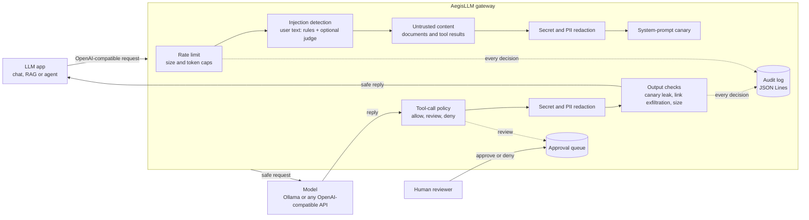

# Architecture

## Request path

1. **Rate limit and caps.** Token bucket per client, maximum request size, and a cap on `max_tokens` (OWASP LLM10).
2. **Injection detection on trusted text.** User messages are scanned by a weighted rule set over several normalised views of the text (plain, de-leeted, de-spaced, letters only, decoded base64, decoded Unicode tag characters). If the score passes the threshold the request is blocked before it reaches the model. The optional judge (a local model with a fixed classification prompt) is asked only when the rules did not already block.
3. **Untrusted content.** Messages with the `tool` role and any `<document>...</document>` block inside a message are data, not instructions. They are held to a stricter threshold and to extra rules for text addressed to "the AI". A poisoned document is removed and the rest of the prompt continues (or the request is blocked, by policy).
4. **Redaction.** Secrets and personal data are replaced with typed placeholders such as `[REDACTED:EMAIL]`.
5. **Canary.** A random marker is appended to the system prompt. It is never shown to users.

## Response path

1. **Tool calls.** Each proposed call is checked against the allowlist and its argument rules (type, length, pattern, enum, denied patterns) and scanned for injected instructions. Allowed calls pass, denied calls are removed, and calls that need review are held in the approval queue. The app polls `/aegis/approvals/{id}` and only runs the tool after a human approves.
2. **Redaction** of secrets and personal data in the reply.
3. **Output checks.** If the canary appears, the system prompt is leaking and the reply is replaced. Links and images to hosts outside the allowlist, and URLs carrying long query strings, are removed.

Every decision, with its findings and timing, is written to the audit log. Snippets are short and already redacted, so the log never stores raw secrets.
